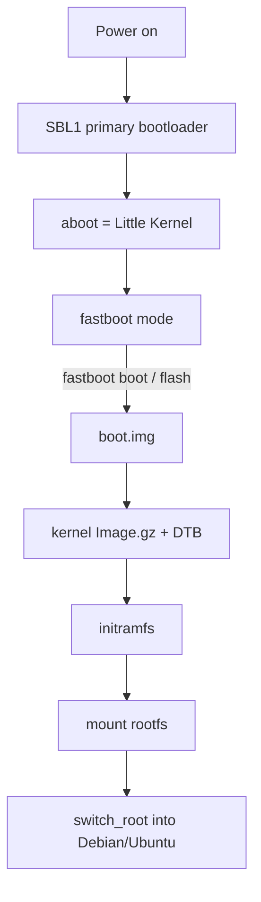
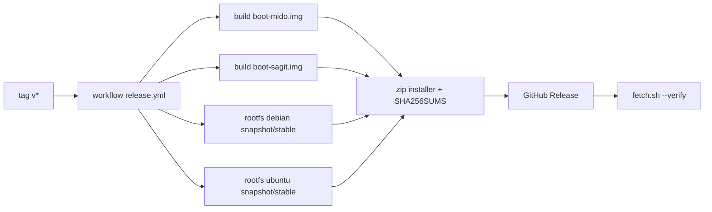

# Architecture and Implementation Plan

Companion document to `PRD.md`. Contents: boot chain, build pipeline, rootfs backends, installation modes, release flow, TWRP installer, phases, risk matrix.

## 1. Boot chain

Neither device has UEFI. The path used:



Implication: no EFI stub, GRUB, or new firmware is required. A valid `boot.img` is enough.
Two kernel sources are supported, selected by `KERNEL_FLAVOR` in `devices/<codename>.env`:

| Flavor | Kernel | DTB | What changes | Risk |
|---|---|---|---|---|
| `mainline` (default) | built from `KERNEL_REPO` | built from source, appended to the kernel | everything | high: every artifact is unproven until a device boots it |
| `stock-repack` | the vendor's, byte for byte | the vendor's, byte for byte | only the initramfs | low: the bootloader already accepts these bytes |

`mainline` on MSM8953/MSM8940 is only proven with a second-stage bootloader: lk2nd has
targets for both (msm8953 for mido, msm8952 with an `msm8940-xiaomi-santoni` DTS for
santoni) and is what KlipperPhonesLinux and postmarketOS use. Stock aboot alone has not
been shown to load a freshly built modern kernel on either SoC. `devices/*.env` gains a
`BOOTLOADER=aboot|lk2nd` key; `aboot` stays the default until lk2nd is verified on
hardware. lk2nd has no msm8998 or Exynos target, so sagit and dreamlte are out of the
near-term mainline matrix.

`stock-repack` exists because a failed mainline attempt on santoni (2026-11-16) left the
device in EDL. It is the same approach as a51-server-os: keep what the bootloader
validates, replace what it does not look at. Xiaomi's published source does not always
contain the device tree (`santoni-n-oss` has no `msm8937-santoni.dts`), so building a
stock kernel from source is not a reliable substitute for the vendor image.


## 2. Kernel build pipeline

1. Fetch the source recorded in `devices/<codename>.env` (kernel.org mainline or a community fork).
2. Cross-compile with `aarch64-linux-gnu-gcc`, targeting `Image.gz` + DTB.
3. Assemble `boot.img` with `mkbootimg`: page size (4096 for UFS, 2048 for eMMC), cmdline, initramfs.
4. Store artifacts in `out/<codename>/` together with checksums.

**Container prerequisites.** `kernel/config/containers.config` is merged after the
per-device fragment (`KCONFIG_FRAGMENT_EXTRA`) and enables namespaces, cgroups
(`PIDS`, `DEVICE`, `FREEZER`, `MEMCG`), `OVERLAY_FS`, `VETH`, `BRIDGE` and NAT.
`scripts/lib/kconfig-check.sh` then proves the options survived the merge; Kconfig drops
a symbol whose dependencies are unmet and `merge_config.sh` only warns. The
`stock-repack` flavor cannot run containers: vendor kernels lack the cgroup controllers.

**Sources used**
- santoni: `MrArtemSid/linux-msm89x7` branch `santoni`, pinned to `f47205ee`. Provides `msm8940-xiaomi-santoni.dts` and `santoni_openwrt_defconfig`. MSM8940 is the Redmi 4X variant of MSM8937. Out-of-tree panel drivers exist in `drm/panel/msm89x7-generated/` (`panel-xiaomi-santoni-hx8394f-boe`, `-ili9881c-ebbg`, `-ili9881c-ebbgdjn`); identify your panel before enabling one.
- sagit: the MSM8998 community fork that explicitly supports the Xiaomi Mi6.
- mido: mainline MSM8953 (base DT since 5.18) or the postmarketOS `qcom-msm8953` kernel as a ready reference.

## 3. initramfs and rootfs
`initramfs/init` is a POSIX shell script run by a static ARM64 busybox:

1. mount `/proc`, `/sys`, `/dev`, `/dev/pts`;
2. set `hung_task_panic = 0` (vendor kernels panic when a task blocks and Android's
   daemons are gone);
3. clear a stale `boot-recovery` message in `misc`, otherwise every reboot returns to
   the recovery loop;
4. bring up a USB gadget with `acm` and `ncm`, retrying for 25 s because the UDC may
   only appear after the cable is detected; this is the rescue console;
5. find the root filesystem: a partition named `debiandroid` (dedicated mode) or
   `<userdata>/debian-server/rootfs` (dual-boot mode);
6. in test mode, arm a dead-man timer of `DEADMAN_SECONDS` (default 300): if the system
   does not write `/var/log/debiandroid/healthy-<boot_id>`, the device reboots;
7. `switch_root` into the rootfs and exec `runit` (or `/sbin/init`).

Build-time settings live in `/debiandroid.conf` inside the archive. Any failure drops to
a shell on the USB serial console instead of hanging silently.

`scripts/initramfs/build.sh <codename> --mode prod|test` assembles the archive with
`scripts/lib/mkcpio.py` (a cpio newc writer in Python, so no `cpio` binary is needed on
the host). Rootfs backends:

- `debian.sh`: `debootstrap --arch=arm64` plus base server packages.
- `ubuntu.sh`: `ubuntu-base` arm64 as the base.
- `prebuilt.sh`: ready image plus server packages.

## 4. Installation modes

| Mode | Mechanism | Risk |
|---|---|---|
| dual-boot | Directory `/data/debian-server/rootfs` on the data partition; no loop device is needed because Android is not running | Android update can overwrite boot; limited space |
| dedicated | Dedicated ext4 partition, Android erased; kernel in the boot partition | Destructive, no return without a restore |

## 5. Networking

- santoni: `usb0` `g_ether` gadget via configfs; Wi-Fi only if the mainline kernel exposes it.
- mido: `wlan0` via `systemd-networkd` + `wpa_supplicant` (WLAN mainline 6.4).
- sagit: `usb0` `g_ether` gadget via configfs; the host gets DHCP over RNDIS.
- Fallback: USB OTG (On-The-Go) Ethernet adapter on all devices.

## 6. Implementation phases

| Phase | Content | Done criteria |
|---|---|---|
| P0 | Documents (PRD, README, AGENTS, design) | Four documents exist and are consistent |
| P1 | Repo skeleton: `devices/*.env.example`, preflight, `--dry-run` | `--dry-run` works for both codenames |
| P2 | santoni kernel + boot.img | `fastboot boot` shows kernel log and running initramfs |
| P3 | initramfs + Debian + dual-boot on santoni | SSH login from the loop rootfs |
| P4 | mido, then sagit: kernel + `usb0` gadget + Debian | SSH over `usb0` succeeds |
| P5 | Ubuntu + prebuilt + dedicated | All three backends and both modes verified |
| P6 | TWRP zip installer + `v*` release workflow | tag `v0.1.0` produces all assets |
| P7 | Automated tests, final documentation | `shellcheck` clean, `bats` green, README final |

## 7. Risk matrix

| Risk | Impact | Mitigation |
|---|---|---|
| Kernel has no device DTB | Boot fails | Test with `fastboot boot` first; keep the old kernel |
| santoni/sagit Wi-Fi not in mainline | No network | `usb0` gadget plus OTG adapter |
| DVFS (Dynamic Voltage and Frequency Scaling) not working | Rapid battery drain | Power-saving script, operational notes |
| Modem dead | Not a phone | Documented limitation; server target |
| Android update overwrites boot | Dual-boot lost | Documented restore procedure |

## 8. Locked decisions

1. No UEFI: direct fastboot path.
2. Initial devices: santoni (hardware on hand), then mido and sagit.
3. Selectable rootfs backend: Debian, Ubuntu, or a prebuilt image.
4. Both dual-boot and dedicated modes are provided and chosen at install time.

## 9. Artifact distribution and CI

Trigger: `v*` tags only. Local builds remain supported for development (`--dry-run`, `--ram-boot`).



Technical notes:
- x86_64 runners with aarch64 cross-compilation.
- The `snapshot` channel pins `snapshot.debian.org` to a fixed timestamp; `stable` uses current mirrors.
- Rootfs is not per device: one ARM64 rootfs serves mido and sagit.

## 10. TWRP zip installer

Zip layout and `update-binary` logic are specified in PRD section 20. Architecture points:

- `update-binary` is POSIX shell, not Bash, so it is safe inside TWRP.
- Device detection: read `ro.product.device` and match it against `config/device.env`.
- `dual-boot`: loop file at `/data/debiandroid/rootfs.img`; the initramfs uses `losetup`.
- `dedicated`: `mkfs.ext4` on the target partition, then write `boot-<codename>.img`.
- Idempotent: if a valid `rootfs.img` already exists, update its contents instead of recreating it.

TWRP risks:
- Older TWRP cannot decrypt `/data` (blocks dual-boot).
- TWRP `/tmp` is small; extract progressively rather than from one blob.

## 11. Verification commands

```bash
shellcheck scripts/**/*.sh
bats tests/
./scripts/flash.sh mido --dry-run
./scripts/fetch.sh --backend debian --channel stable --verify --dry-run
```

On-device after install:

```bash
findmnt / && ip -br a && systemctl status ssh
```

## 12. Source pinning and partition safety

Two guards adopted from a comparable hardware bring-up project (Xiaomi Mi 11 Pro native UEFI port). Neither depends on UEFI.

**Source pinning.** `devices/<codename>.env` records `KERNEL_REPO`, `KERNEL_REF`, `KERNEL_COMMIT` (40-hex pin) and `KERNEL_ARCHIVE_SHA256` (optional tarball checksum). `scripts/lib/kernel-pin.sh` checks the pin against the remote without cloning; `scripts/build-kernel.sh` then compares `HEAD` to `KERNEL_COMMIT` and aborts on mismatch. This keeps builds reproducible across machines and months.

**Partition identity guard.** Before any `mount` or `mkfs`, the installer confirms:

1. the block device `PARTNAME` matches `ROOT_PARTNAME_EXPECTED`, and
2. the target filesystem contains `ROOT_MARKER` (default `/etc/debiandroid-root`) when the mode is dual-boot or reinstalling.

Dedicated mode additionally requires an explicit `--format` flag; a missing flag aborts instead of guessing. `scripts/lib/partition-guard.sh` implements both checks and is reused by `install.sh` and the TWRP `update-binary`.

## 13. CI build pipeline

Two workflows, both Ubuntu 24.04 runners (x86_64) with an AArch64 cross toolchain.

| Workflow | Trigger | Job |
|---|---|---|
| `build-kernel.yml` | `workflow_dispatch` (choose codename) or `v*` tag | preflight, pin verify, kernel build, `boot.img`, checksums, artifact upload |
| `release.yml` | `v*` tag | matrix over codenames, build, then publish `boot-<codename>.img` + `SHA256SUMS` to the Release |

Device-specific kernel configuration is expressed as a base defconfig plus a Kconfig fragment in `kernel/config/<codename>-server.config`, merged with `scripts/kconfig/merge_config.sh`. For santoni the base is `santoni_openwrt_defconfig` from the pinned community tree, and the fragment adds the missing server essentials: USB configfs gadget (NCM/RNDIS/ECM), ext4, loop devices, initramfs support, netfilter.

The runner compiles only kernel and boot image. Rootfs tarballs are built separately and published as release assets; they are not part of the kernel job.

Local dry runs (`--dry-run`) exercise the same code paths without a toolchain, so the workflow logic can be checked on any host.
